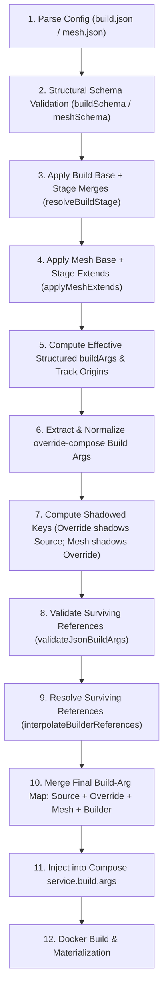

# Master Implementation Plan: First-Class `buildArgs` Support (V3.1.0)

**Package:** `@solid-stack/builder`  
**Target Version:** `3.1.0` (or V3 minor update)  
**Normative Feature Specification:** [feature_spec_v3.1.0.md](file:///home/erwin/Documents/solid-stack-digital/test/ssd-ecosystem/builder/.docs/specs_v3/feature_spec_v3.1.0.md)  
**Status:** Approved for Implementation  
**Scope:** `services.main` only  

---

## 1. Executive Summary

In Builder V3.0.0, Docker build arguments could only be provided indirectly through `override-compose`. While functional for advanced Docker Compose mechanics, this broke Builder's core configuration ethos: common build-time configuration should be explicit, typed, and Builder-native, with full support for stage overrides, mesh inheritance, and dynamic endpoint references.

Feature Specification V3.1.0 introduces first-class Docker build argument configuration:

```json
{
  "services": {
    "main": {
      "buildArgs": {
        "BASE_PATH": "/web",
        "NEXT_PUBLIC_API_URL": "${gateway.source.main.endpoints.http.public_url}/api"
      }
    }
  }
}
```

### Core Tenets of the Feature:
1. **Strict Scope**: Supported strictly on `services.main` in `build.json` and `extends.main` in `mesh.json`. Normal services and tester services are forbidden from defining `buildArgs`.
2. **Strings-Only Values**: Every `buildArgs` value must be a string. Empty strings `""` are preserved. Non-strings (integers, booleans, objects, arrays) are rejected by fail-fast schema validation.
3. **No Implicit Env Conversion**: `.env.<stage>` files NEVER participate in Docker build arguments.
4. **Endpoint Reference Interpolation**: `${...}` references in `buildArgs` resolve dynamically following all V3 reference rules (requisite closure check, public publication requirement, URL scheme requirement).
5. **Merge-Before-Validation Order**: Effective merging occurs *before* reference validation. Crucially: **a reference shadowed by a higher-precedence value MUST NOT be resolved or rejected**.
6. **Harmonized Precedence Ladder**: Matches the structural authority order of `env`:
   - Standalone: `base < stage < override-compose < Builder`
   - Mesh: `source base < source stage < source override-compose < mesh base < mesh stage < Builder`
7. **Deterministic Final Docker Ingestion**: Produces a unified `Record<string, string>` supplied to `docker compose` as `service.build.args`.

---

## 2. Canonical Precedence Architecture

The build-arg precedence model mirrors runtime `env` structural authority, with `.env` files completely excluded:

```mermaid
flowchart TD
    subgraph Standalone ["Standalone Build Arg Precedence (Low to High)"]
        S1["1. Base services.main.buildArgs"] --> S2["2. Stage services.main.buildArgs (E2E: base -> prod -> e2e)"]
        S2 --> S3["3. Effective override-compose build args"]
        S3 --> S4["4. Builder-owned build args (Highest)"]
    end

    subgraph Mesh ["Mesh Build Arg Precedence (Low to High)"]
        M1["1. Source Base services.main.buildArgs"] --> M2["2. Source Stage services.main.buildArgs (E2E: prod -> e2e)"]
        M2 --> M3["3. Effective Source override-compose build args"]
        M3 --> M4["4. Mesh Base extends.main.buildArgs"]
        M4 --> M5["5. Mesh Stage extends.main.buildArgs (E2E: prod -> e2e)"]
        M5 --> M6["6. Builder-owned build args (Highest)"]
    end
```



> [!IMPORTANT]
> In mesh composition, mesh `extends.main.buildArgs` takes precedence over source `override-compose` build arguments. This allows platform meshes to configure global frontend gateway URLs even when local service packages supply default Docker Compose override files.

---

## 3. Compilation Pipeline & Compile Order

Section 13 of [feature_spec_v3.1.0.md](file:///home/erwin/Documents/solid-stack-digital/test/ssd-ecosystem/builder/.docs/specs_v3/feature_spec_v3.1.0.md#L532) dictates the conceptual compilation order:



---

## 4. Acceptance Criteria & Test Invariant Traceability Matrix

Every acceptance criterion defined in §22 of [feature_spec_v3.1.0.md](file:///home/erwin/Documents/solid-stack-digital/test/ssd-ecosystem/builder/.docs/specs_v3/feature_spec_v3.1.0.md#L963) is assigned a dedicated invariant test ID (`BAR01` – `BAR25`):

| Test ID | Spec § | Acceptance Criterion Description | Verification Scope | Target Test File |
|---|---|---|---|---|
| **`BAR01`** | §4.1, §22.1 | `build.json` supports first-class `services.main.buildArgs` | Schema & resolution | `tests/v3/buildArgs.test.ts` |
| **`BAR02`** | §4.2, §22.2 | All build stages (`dev`, `prod`, `test`, `e2e`) support `services.main.buildArgs` | Schema & stage merging | `tests/v3/buildArgs.test.ts` |
| **`BAR03`** | §4.3, §22.3 | Mesh base `services.<name>.extends.main.buildArgs` accepted | Mesh schema & resolution | `tests/v3/buildArgs.test.ts` |
| **`BAR04`** | §4.4, §22.3 | Mesh stages (`dev`, `prod`, `e2e`) `extends.main.buildArgs` accepted | Mesh stage resolution | `tests/v3/buildArgs.test.ts` |
| **`BAR05`** | §5, §22.4 | Normal services reject `buildArgs` (e.g. `services.db.buildArgs`) | Schema rejection | `tests/v3/buildArgs.test.ts` |
| **`BAR06`** | §5, §22.5 | `services.tester` rejects `buildArgs` | Schema rejection | `tests/v3/buildArgs.test.ts` |
| **`BAR07`** | §5, §22.4 | Mesh non-main extends (e.g. `extends.db.buildArgs`) rejected | Mesh schema rejection | `tests/v3/buildArgs.test.ts` |
| **`BAR08`** | §6.1, §22.6 | Values must be strings only; non-strings (number, bool, null, obj, arr) rejected | Type & schema rejection | `tests/v3/buildArgs.test.ts` |
| **`BAR09`** | §6.2 | Empty strings `""` in `buildArgs` are preserved | Merge preservation | `tests/v3/buildArgs.test.ts` |
| **`BAR10`** | §8, §21 | Object merge semantics: stage overlay overrides and inherits keys | Stage merge | `tests/v3/buildArgs.test.ts` |
| **`BAR11`** | §9.4, §22.8 | E2E inherits prod structured build args (`base -> prod -> e2e`) | E2E stage chain | `tests/v3/buildArgs.test.ts` |
| **`BAR12`** | §9.1–9.3 | Standalone precedence: `base < stage < override-compose < Builder` | Composition compile | `tests/v3/buildArgs.test.ts` |
| **`BAR13`** | §9.5–9.6 | Mesh precedence: `source base < source stage < source override < mesh base < mesh stage` | Mesh composition compile | `tests/v3/buildArgs.test.ts` |
| **`BAR14`** | §9.7 | Global E2E mesh precedence: `source base -> prod -> e2e -> override -> mesh base -> prod -> e2e` | Mesh E2E compile | `tests/v3/buildArgs.test.ts` |
| **`BAR15`** | §10, §22.10 | Mesh `extends.main.buildArgs` beats source `override-compose` build args | Mesh override collision | `tests/v3/buildArgs.test.ts` |
| **`BAR16`** | §6.3, §22.7 | `.env.<stage>` never contributes build args unless explicitly in `buildArgs` | Env isolation | `tests/v3/buildArgs.test.ts` |
| **`BAR17`** | §7 | Self-reference in `buildArgs` (`${main.endpoints.http.public_url}`) resolves | Reference engine | `tests/v3/buildArgs.test.ts` |
| **`BAR18`** | §7, §22.11 | Requisite endpoint reference in `buildArgs` resolves | Reference engine | `tests/v3/buildArgs.test.ts` |
| **`BAR19`** | §7, §22.12 | Reference without declared requisite fails; references never create requisites | Graph closure check | `tests/v3/buildArgs.test.ts` |
| **`BAR20`** | §7 | Reference to pruned / unreachable target fails | Execution profile check | `tests/v3/buildArgs.test.ts` |
| **`BAR21`** | §13–14, §22.13 | Shadowed invalid reference is NOT validated or rejected | Shadowing compiler pass | `tests/v3/buildArgs.test.ts` |
| **`BAR22`** | §13–14, §22.14 | Surviving invalid reference fails with descriptive ConfigError | Reference validation | `tests/v3/buildArgs.test.ts` |
| **`BAR23`** | §11, §22.16 | Builder-owned build args take precedence; user definition fails fast | Reserved key guard | `tests/v3/buildArgs.test.ts` |
| **`BAR24`** | §12, §22.15 | Final resolved build args are supplied to Docker Compose `service.build.args` | Compose document | `tests/v3/buildArgs.test.ts` |
| **`BAR25`** | §21 | Real Docker build passes effective build args to Dockerfile `ARG` (`RUN test "$VAR" = "..."`) | Real Docker acceptance | `tests/v3/docker/buildArgs.test.ts` |

---

## 5. Pinned Design & Implementation Decisions

| ID | Topic | Decision | Justification |
|---|---|---|---|
| **D-BAR-01** | Schema Strictness | Only `mainServiceSchema`, `mainOverlaySchema`, and `meshMainOverlay` include `buildArgs`. All other service schemas are `.strict()`. | Guarantees instant fail-fast rejection for ordinary services and tester in all stages. |
| **D-BAR-02** | Values Type | `z.record(z.string(), z.string())`. Reject non-strings with Zod type error. | Spec §6.1 mandates strings only. |
| **D-BAR-03** | Override Normalization | Implement `normalizeComposeBuildArgs(value, context)` supporting both mapping `{ K: "V" }` and list `["K=V"]`. | Robust compatibility with standard Compose format while producing a canonical `Record<string, string>`. |
| **D-BAR-04** | Origin & Scope Tracking | Track `buildArgsOrigins` on `EffectiveBuildConfig` and `GraphNode`, with `scope: "build"` vs `scope: "mesh"`. | Identical to `envOrigins`. Enables distinguishing source-level vs mesh-level declarations during precedence resolution. |
| **D-BAR-05** | Shadowing Order | In standalone, `override-compose` build args shadow all source build args. In mesh, `override-compose` shadows source build args, but mesh `extends.main.buildArgs` shadows both source and override build args. | Satisfies Spec §9 and §10 ("mesh extends.main.buildArgs beats source override-compose"). |
| **D-BAR-06** | Validation Timing | Implement `validateJsonBuildArgs(...)` alongside `validateJsonEnv(...)` before port allocation, skipping keys in `shadowed`. | Enforces Spec §13: shadowed references must never fail validation. |
| **D-BAR-07** | Compose Output | If `effectiveBuildArgs` contains keys, or if `override-compose` defined `build.args`, assign `(service.build as Record<string, unknown>).args = effectiveBuildArgs`. | Supplies clean, standard Docker Compose build args to Docker daemon. |

---

## 6. Execution Order & Steps

Execute the work sequentially across the 4 plan chapters:

1. **Step 1: Types & Schema Engine** (documented in [01_SCHEMA_TYPES_AND_VALIDATION.md](file:///home/erwin/Documents/solid-stack-digital/test/ssd-ecosystem/builder/.docs/execution_docs/05-implement_v3.1/01_SCHEMA_TYPES_AND_VALIDATION.md))
   - Update `src/types/index.ts`, `src/core/config/types.ts`.
   - Update `src/core/buildSchema.ts`, `src/core/mesh/meshSchema.ts`.
   - Update `scripts/generate-schemas.ts` and regenerate `schemas/build-schema.json`, `schemas/mesh-schema.json`.
   - Run tests `BAR01`–`BAR09` and verify schema generator tests.

2. **Step 2: Stage & Mesh Merging Engine** (documented in [02_STAGE_MERGE_AND_MESH_EXTENDS.md](file:///home/erwin/Documents/solid-stack-digital/test/ssd-ecosystem/builder/.docs/execution_docs/05-implement_v3.1/02_STAGE_MERGE_AND_MESH_EXTENDS.md))
   - Update `resolveBuildStage.ts` to record `buildArgsOrigins` and default `buildArgs: {}`.
   - Update `applyMeshExtends.ts` to record mesh-scoped `buildArgsOrigins`.
   - Run tests `BAR10`–`BAR11`.

3. **Step 3: Precedence, Reference Interpolation, and Override-Compose Engine** (documented in [03_PRECEDENCE_REFERENCES_AND_OVERRIDE_COMPOSE.md](file:///home/erwin/Documents/solid-stack-digital/test/ssd-ecosystem/builder/.docs/execution_docs/05-implement_v3.1/03_PRECEDENCE_REFERENCES_AND_OVERRIDE_COMPOSE.md))
   - Add `normalizeComposeBuildArgs` helper.
   - Update `validateOverrideCompose.ts` for `services.main.build.args`.
   - Update `compileGraphComposition.ts` with `resolveJsonBuildArgs`, `validateJsonBuildArgs`, precedence resolution, and `service.build.args` assignment.
   - Run tests `BAR12`–`BAR23`.

4. **Step 4: Docker Build Integration & Verification** (documented in [04_DOCKER_BUILD_INTEGRATION_AND_ACCEPTANCE_TESTS.md](file:///home/erwin/Documents/solid-stack-digital/test/ssd-ecosystem/builder/.docs/execution_docs/05-implement_v3.1/04_DOCKER_BUILD_INTEGRATION_AND_ACCEPTANCE_TESTS.md))
   - Compose document verification (`BAR24`).
   - Real Docker test execution (`BAR25`).
   - Run full regression suites: `pnpm typecheck`, `pnpm test:v3:fast`, `pnpm test:docker`.
